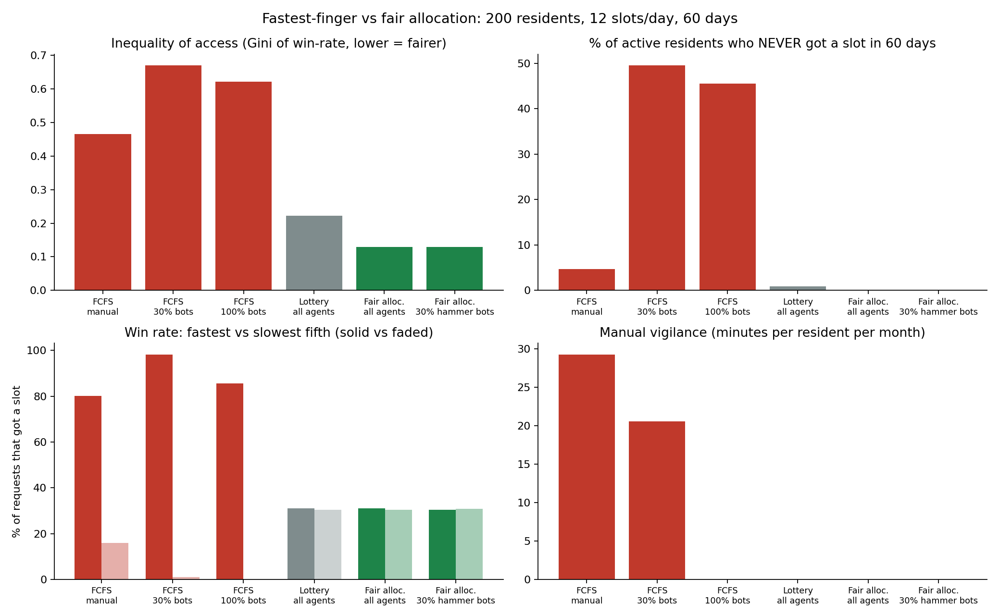
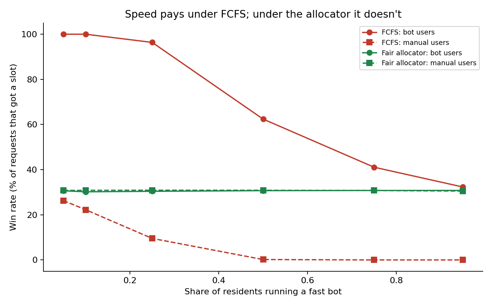

# FairSlot: fair booking for oversubscribed experiences

> Automating the race doesn't fix the race. FairSlot replaces "fastest finger first" with a
> declared-interest window and a fair draw, so nobody needs to refresh, and having an assistant
> gives you no speed advantage.

## The problem
Popular slots (society tennis courts, badminton, F1 and PVR tickets) open at a fixed time and go
to whoever refreshes fastest. Survey respondents describe staying "on the app 13 days in
advance" or logging in "exactly 30 minutes before the show". Organisers also lose slots while
their group is still deciding.

The obvious fix, an agent that books faster, breaks the moment everyone runs one. The test for a
real solution: **it still gets you the court when everyone in the building is running it too.**

## The idea
Two layers, kept strictly separate:

1. **Agents translate.** An LLM turns "tennis, weekday evenings, 2 hrs, under ₹700" into a validated
   structured preference. A group agent finds the slot most of your friends can do and enters the
   draw only once a quorum confirms.
2. **A deterministic allocator decides.** A window collects declared interests, then a weighted
   lottery with fairness credits allocates slots. Losers gain odds, recent winners lose odds.
   There is no LLM in this layer, and submission order and speed are never inputs.

```
 free text ──► Personal agent ──┐
                                ├─► validated Interest ─► FairAllocator ─► award + explanation
 friends' messages ─► Group agent ┘   (utilities per slot)   (window → weighted draw → best free slot)
        │  LLM: parse / word messages            no LLM, no speed inputs
        └─ falls back to rule-based parser if the LLM fails or returns garbage
```

Because each person takes their highest-utility free slot and the draw order does not depend on
what they declare, reporting true preferences is the best strategy. Hiding or inflating them
cannot improve your position in the draw.

## Results (simulated: 200 residents, 12 slots/day, 60 days, 20 runs)

| Scenario | Demand served | Gini (win-rate) | Shut-out rate | Fast-quintile win % | Slow-quintile win % | Vigilance min/mo |
|---|---|---|---|---|---|---|
| FCFS, all manual | 31% | 0.47 | 5% | 80% | 16% | 29 |
| FCFS, 30% bots | 31% | 0.67 | 50% | 98% | 1% | 21 |
| FCFS, 100% bots | 31% | 0.62 | 45% | 86% | 0% | 0 |
| Lottery (no credits) | 31% | 0.22 | 1% | 31% | 30% | 0 |
| **Fair allocator, all agents** | 31% | **0.13** | **0%** | 31% | 30% | 0 |
| **Fair allocator, 30% hammer bots** | 31% | **0.13** | **0%** | 30% | 31% | 0 |

- **Bots do not end the arms race under FCFS.** Even at 100% adoption, connection latency decides:
  the fastest fifth wins 86% of the time and the slowest fifth 0%.
- **Under the allocator, speed is irrelevant.** Bots and manual users win at the same rate (about
  31%) at every adoption level from 5% to 95% (`results/sweep.json`).
- **Fairness credits matter.** A plain lottery already removes the speed advantage, but the credits
  cut inequality further (Gini 0.22 to 0.13).
- **Total supply doesn't change.** Demand served and slot quality are identical across scenarios.
  The gain is who gets access and the vigilance saved, not more slots.




## Student concept validation (20 participants)

Twenty IIT Hyderabad students provided qualitative feedback on the booking concept. Key needs included **lottery transparency and fairness-credit explanations**, **editable LLM-parsed preferences**, **precise/ranked slot selection**, **group confirmation and cancellation flows**, and **notifications and abuse safeguards**.

These are exploratory concept responses, not measured product adoption or a deployed usability test. See [research/student_concept_validation.md](research/student_concept_validation.md) for anonymized evidence, themes, priorities, and limitations.

## Live parser evaluation harness

Run `python fairslot_live_eval.py` with `GROQ_API_KEY` securely set to evaluate 20 authored natural-language requests. The script records exact-case and expected-field accuracy, parser source (LLM or rules), latency, and errors in `fairslot_live_eval_results.csv`.

**Important:** The repository contains an evaluation *harness*, not a verified success rate. Results must be generated and reviewed before claiming live-model accuracy. The 20 test prompts are separate from the 20 student concept-feedback records; a fallback parse must not be reported as successful LLM parsing.

## Run it
```bash
pip install -r requirements.txt
python run_experiment.py          # reproduces results/*.png, results.md, results.json
python demo.py                    # end-to-end agent demo (tennis courts, 8 residents + a group)
python tests/test_agents.py       # allocator, parsers, guardrails, group quorum
python tests/test_simulation.py   # headline claims on a small run
```
LLM mode: `GROQ_API_KEY=... python demo.py` (model set by `SLOT_AGENT_MODEL`, default
`llama-3.3-70b-versatile`). Without a key, or with `SLOT_AGENT_OFFLINE=1`, everything runs offline.
The provider call lives in one function, `call_llm` in `agents.py`; any OpenAI-compatible provider
works with a small change there. In the demo output, `[llm]` vs `[rules]` shows which parser was used.

## Repo layout
| File | Role |
|---|---|
| `allocator.py` | Deterministic allocator: window, weighted draw, fairness credits, explanations |
| `agents.py` | Personal agent: LLM parsing, validation, rule-based fallback, slot utility |
| `group_agent.py` | Group agent: availability overlap, proposal, quorum, group interest |
| `simulator.py` | Monte Carlo simulator of FCFS vs lottery vs fair allocation |
| `metrics.py` | Gini, shut-out rate, fast vs slow win rate, vigilance, welfare, server load |
| `experiments.py` | Scenarios and the bot-adoption sweep |
| `run_experiment.py` | Runs the experiments and writes `results/` |
| `demo.py` | End-to-end demo of agents plus allocator over 3 booking windows |
| `fairslot_live_eval.py` | Live API evaluation harness for 20 authored preference prompts |
| `research/student_concept_validation.md` | Anonymized 20-student concept feedback and product priorities |
| `tests/` | Plain-assert tests (also runnable with pytest) |

## Design decisions
- **LLM as translator, not decider.** LLM output is untrusted: it is schema-validated, clamped,
  and unknown keys are dropped, so a prompt-injected "priority": "max" has nowhere to go
  (tested). If the LLM fails, a rule-based parser takes over.
- **Groups.** A group's odds weight is the average of its members', so forming a group never beats
  going solo. A group needs a quorum of confirmations before it enters the draw.
- **Explanations.** Every result says why ("Drawn 9 of 9, odds weight next window: 1.60"), which
  matters for trust when a lottery says no.

## Limitations (please read)
- **Simulated, not field data.** Population parameters (15% of humans vigilant at window open, the
  latency distribution, demand levels) are assumptions, not survey measurements.
- **Fairness rule is one design.** The credit formula (`allocator.py`) is a reasonable choice, not
  a proven optimum; other rules and their trade-offs are not compared here.
- **Live LLM evaluation results not yet verified.** The repository provides a 20-case live API harness; no accuracy figures are reported without executing and reviewing it. Existing mocks test error handling and fallback.
- **Assumes a cooperative venue.** The venue must adopt a declared-interest window. This repo does
  not scrape or book on real platforms, which also keeps it clear of platform terms.
- **Non-participants.** People who never declare interest are not modelled. A real rollout needs a
  low-friction way in for them.

## Roadmap
Discovery agent (ranked event digest instead of the Thursday-evening scroll), a pilot with one
condo or club app as the venue, comparison of alternative fairness rules, and structured usability testing of the parsing
and group flow. Concept feedback from 20 students is documented, but usability metrics and a venue pilot remain future work.
